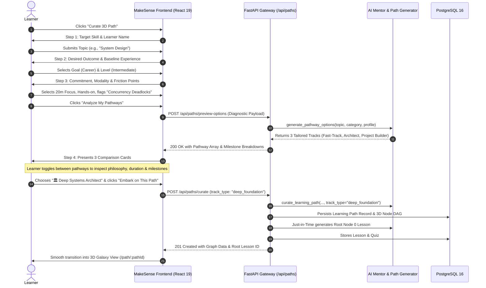
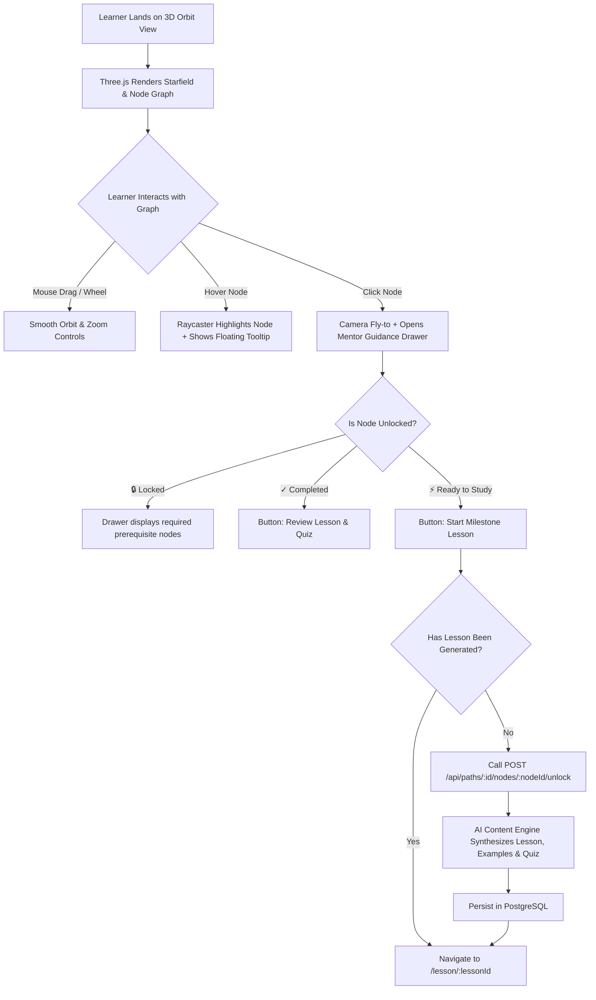
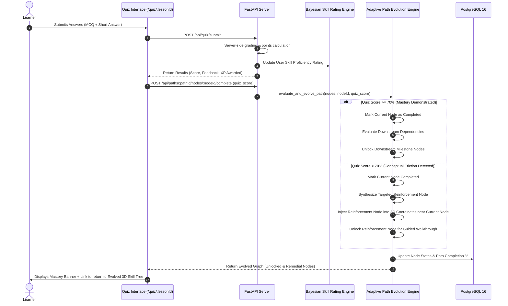
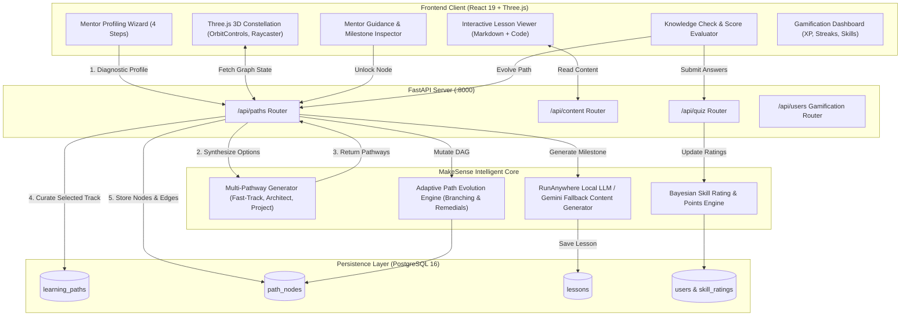

# 🗺️ MakeSense User Flows & Architectural Lifecycles

This document details the user journeys, decision matrices, and system interactions within MakeSense, highlighting the **AI Mentor Intake Wizard**, **Multi-Pathway Comparison Engine**, **3D Evolving Skill Galaxy (Three.js)**, and **Adaptive Quiz Reinforcement Loop**.

---

## 1. Diagnostic Intake & Multi-Pathway Selection Flow

Rather than dumping monolithic content upfront, MakeSense begins with a 4-step diagnostic conversation. The AI Mentor profiles the learner and generates 2–3 distinct educational strategies with trade-offs.

---

## 2. 3D Constellation Navigation & Just-in-Time Generation

Learners explore their personalized curriculum as an interactive Three.js 3D constellation. Subsequent lessons are not pre-baked; they are compiled **just-in-time** when the learner enters the node.

---

## 3. Quiz Evaluation & Adaptive Path Evolution Loop

When a learner finishes a lesson, they take an active-recall quiz. The system evaluates mastery and **dynamically mutates the 3D graph**.

---

## 4. Complete System Architecture & Data Flow

